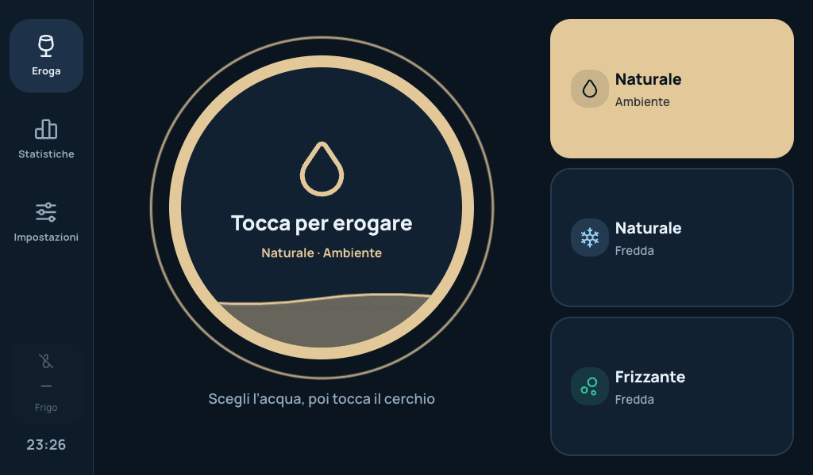
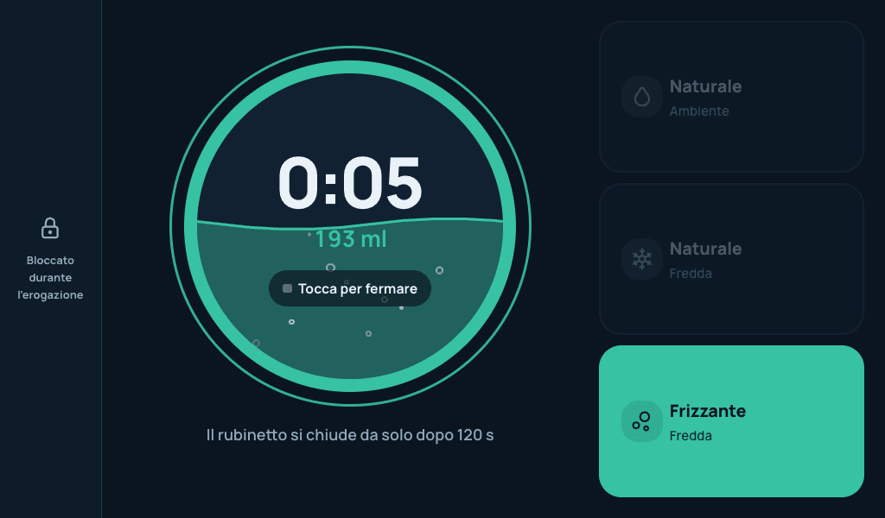
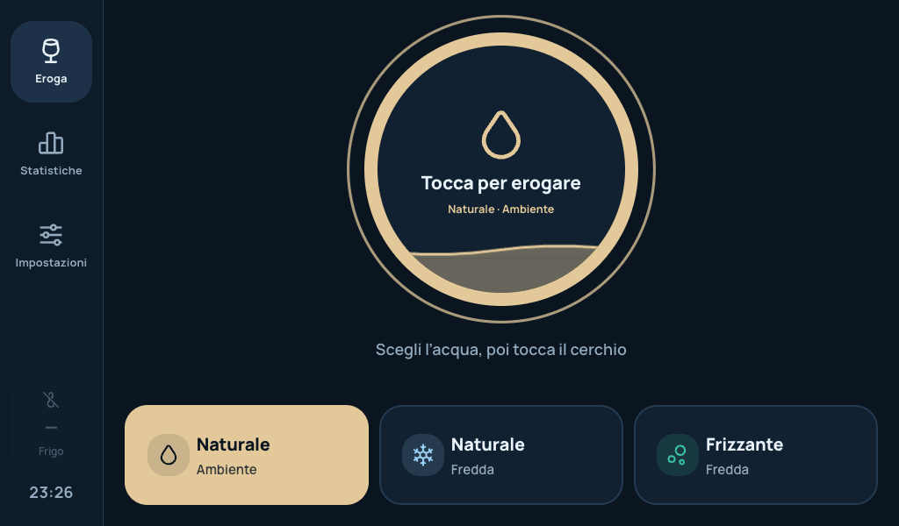
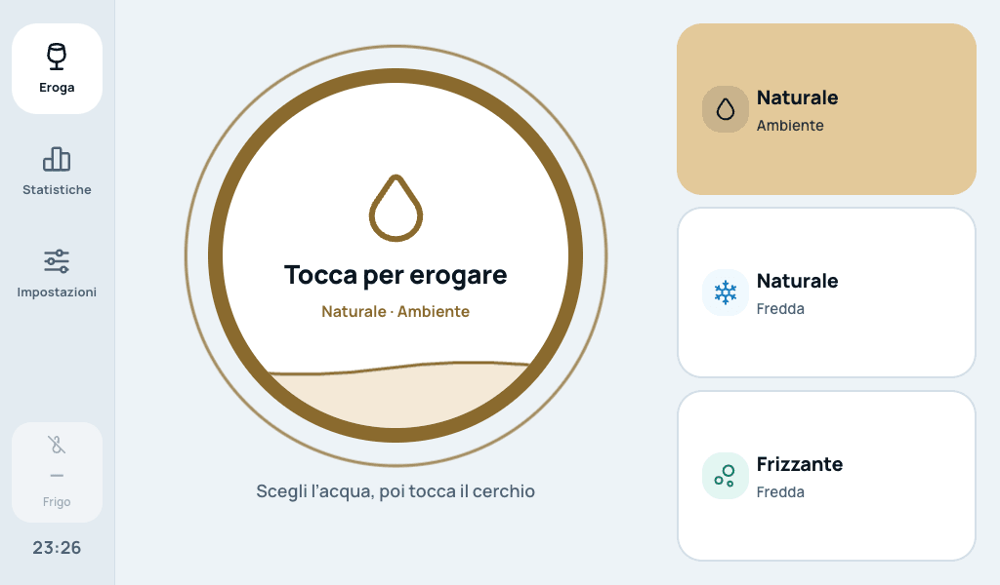
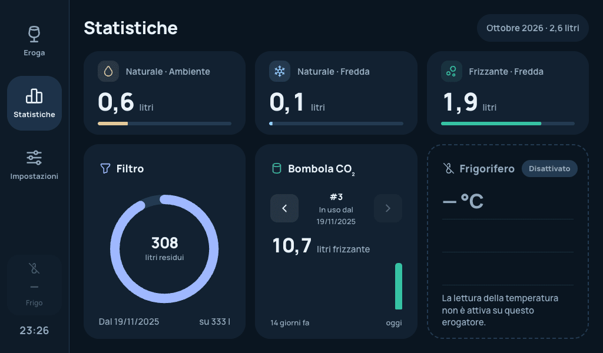
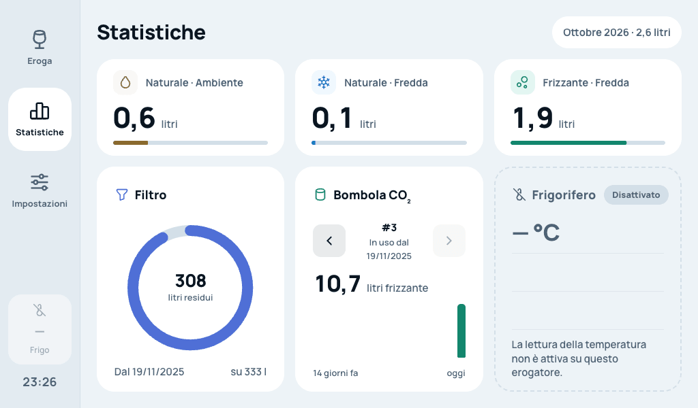
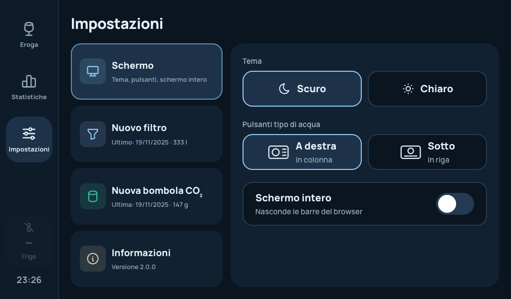
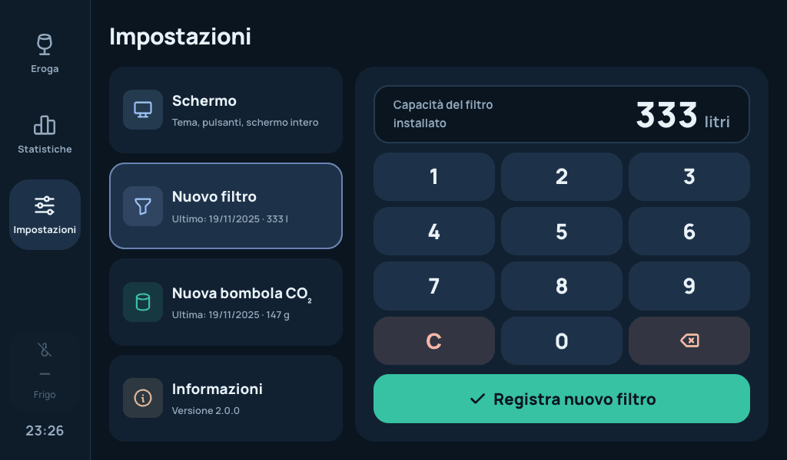
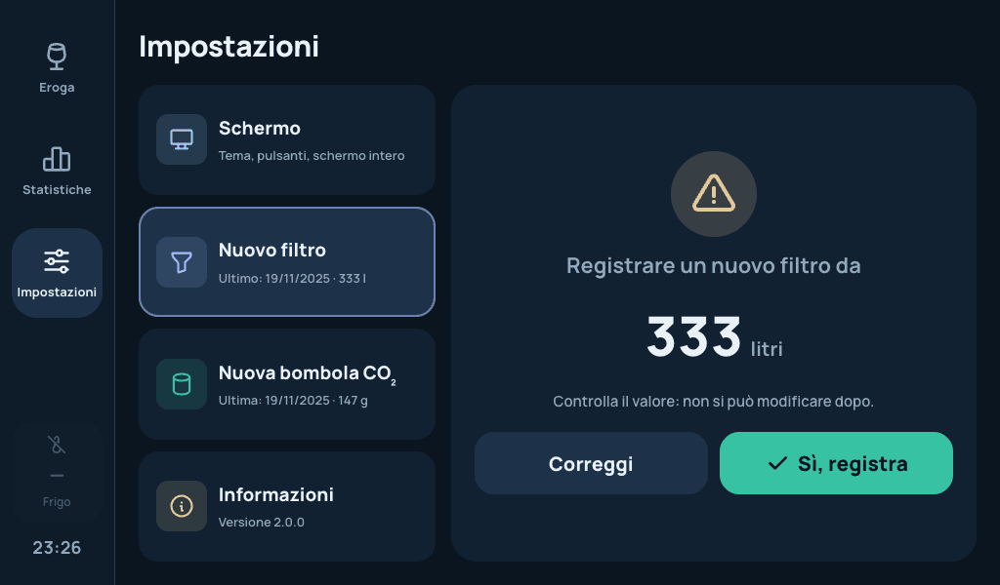
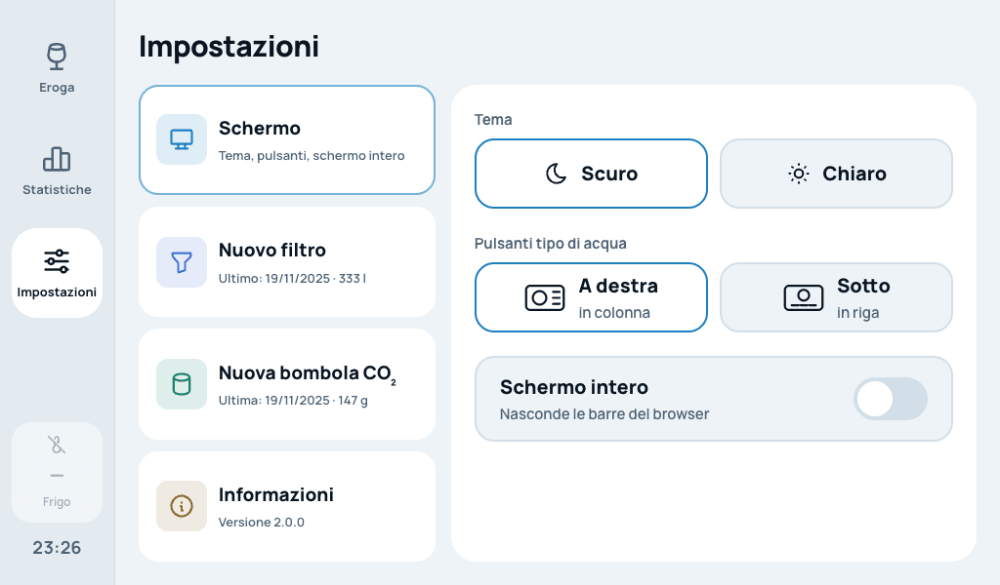

# Water Dispenser

Companion app for the **BWT AQA drink U20 CAS**: a touchscreen interface (Next.js) that runs directly on the board driving the dispenser (Orange Pi / Armbian), dispensing room-temperature still water, cold still water, and cold sparkling water by controlling relays, and tracking dispenses, filter changes, tank refills, and fridge temperature.

## Screenshots

Captured at 1024×600, the resolution of the dispenser's display (`npm run screenshots`, see below).

| | |
| --- | --- |
|  |  |
| Dispensing, at rest | Dispensing, sparkling water running |
|  |  |
| Water types in a row at the bottom | Light theme |
|  |  |
| Stats | Stats, light theme |
|  |  |
| Settings, screen | Settings, new filter keypad |
|  |  |
| Confirmation before registering | Settings, light theme |

## How it works

- **Dispensing**: from the home screen you pick a water type (`Naturale Ambiente`, `Naturale Fredda`, `Frizzante Fredda`), press *Avvio* to open the corresponding relay and *Stop* to close it; the dispense duration is recorded and the quantity (ml) is estimated as `duration × flow factor (ml/sec)` for that relay (see `src/service/utils.ts`).
- **Filter**: from Settings you can log a filter replacement by entering the liters dispensed; the stats page shows consumption per dispense type since the last replacement.
- **Tank (sparkling)**: from Settings you log a refill of the CO₂/sparkling water tank; the stats page shows daily sparkling water consumption.
- **Fridge temperature**: a background process periodically reads the 1-Wire temperature sensor and stores the readings, shown in a chart on the Stats page.
- All data is persisted in a local **SQLite** database (no external services required).
- The app is designed to be shown full-screen on the dispenser's display (see the *Fullscreen* toggle in Settings).

## Configuration

Behavior (real hardware vs. development on a PC) is controlled via environment variables, read from `.env.development` in dev and `.env.production` in production:

| Variable | Description |
| --- | --- |
| `DB_FILE` | Path to the SQLite file. |
| `TEMPERATURE_FILE` | Path to the sysfs file of the 1-Wire temperature sensor (e.g. `/sys/bus/w1/devices/28-.../temperature`); in development a dummy value (`dummy`) is used and GPIO/sensor calls are automatically mocked with a console log. |
| `READ_TEMP_ENABLED` | Enables periodic polling of the fridge temperature. |
| `READ_TEMP_DELTA_SEC` | Interval (in seconds) between two temperature readings. |

In development, without real hardware attached, the app still works: any GPIO command that fails is logged and simulated instead of interrupting execution.

## Getting Started

First, run the development server:

```bash
npm run dev
# or
yarn dev
# or
pnpm dev
# or
bun dev
```

Open [http://localhost:3000](http://localhost:3000) with your browser to see the result.

You can start editing the page by modifying `app/page.tsx`. The page auto-updates as you edit the file.

This project uses [`next/font`](https://nextjs.org/docs/basic-features/font-optimization) to automatically optimize and load Inter, a custom Google Font.

## Build Docker image

The Docker image is meant to run on the dispenser's board: in the final stage of the `Dockerfile`, `wiringOP-next` (the `gpio` tool used to drive the relays) is compiled and installed, in addition to the Next.js standalone build.

To build the image and publish it to the local registry, use the `build-push.sh` script:

```bash
./build-push.sh
```

The script:
1. reads the current version from `package.json` (`jq -r .version package.json`);
2. builds the image, tagging it as `192.168.1.254:5000/water-dispenser:<version>`;
3. pushes the image to the `192.168.1.254:5000` registry.

Before running it, remember to bump the version in `package.json` (it is also shown in the app's Settings page).

### Deploy

On the device, the image is run via `docker-compose.yml`:

```bash
docker compose up -d
```

Deploy notes:
- the container runs in `privileged` mode and mounts the `/sys/bus/w1/devices` volume (temperature sensor) and `/etc/armbian-release`, needed for real hardware access;
- SQLite database data is persisted on the host at `/home/manuel/water-dispenser/data`, mounted at `/app/data` in the container;
- the app is exposed on port `80`.

Before updating, align the image tag in `docker-compose.yml` with the version just published by `build-push.sh`.
