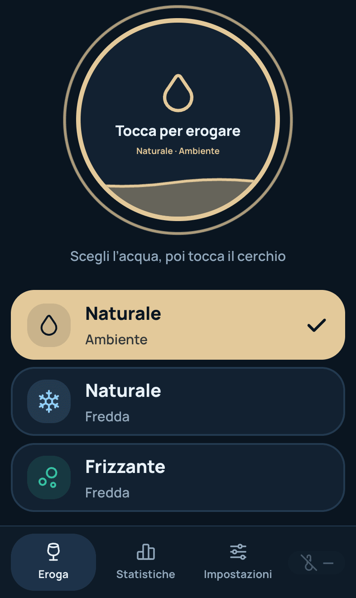
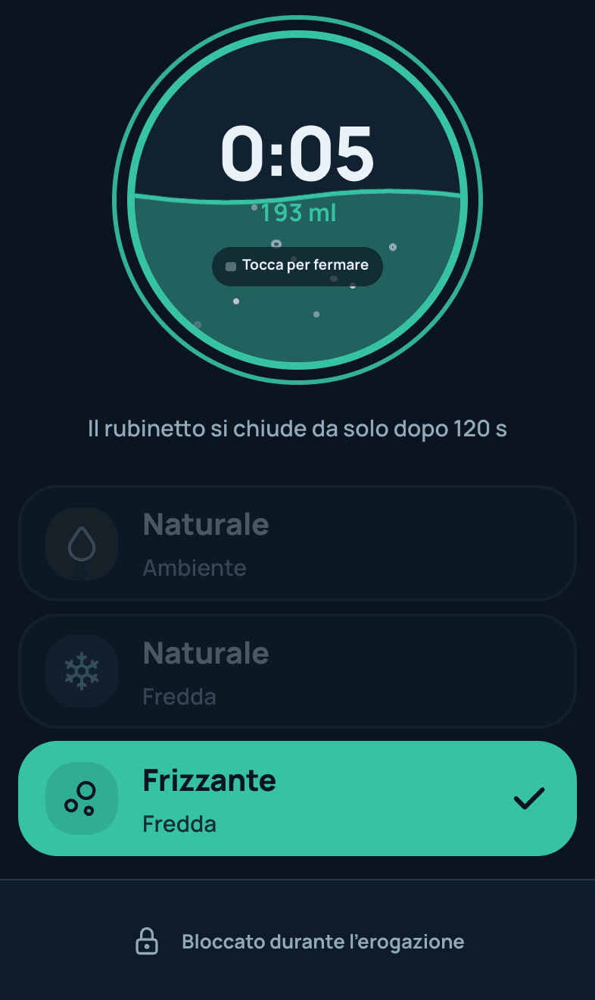
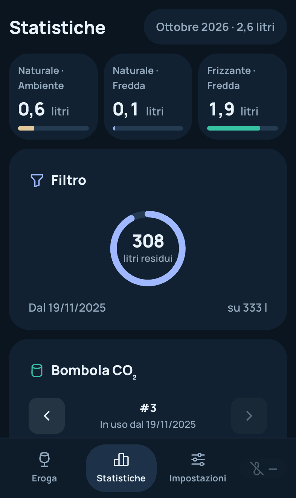
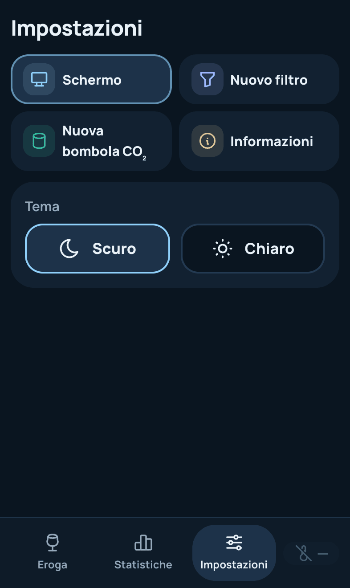
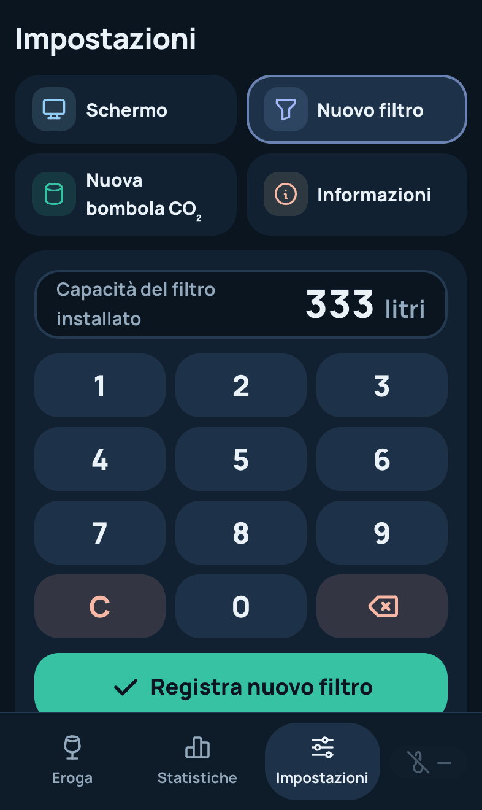
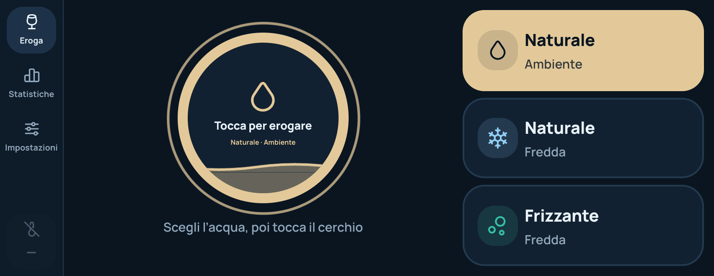
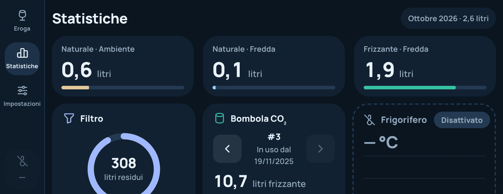
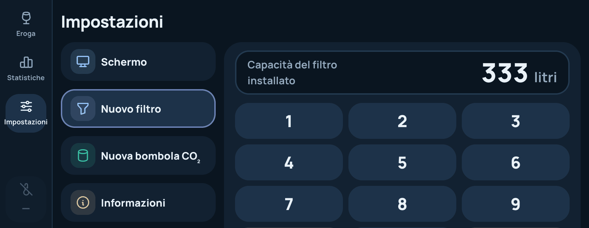

# Water Dispenser

Companion app for the **BWT AQA drink U20 CAS**: a touchscreen interface (Next.js) that runs directly on the board driving the dispenser (Orange Pi / Armbian), dispensing room-temperature still water, cold still water, and cold sparkling water by controlling relays, and tracking dispenses, filter changes, tank refills, and fridge temperature.

## Screenshots

Captured at 1024×600, the resolution of the dispenser's display (`npm run screenshots`, see below).

| | |
| --- | --- |
|  |  |
| Dispensing, at rest | Dispensing, sparkling water running |
|  |  |
| Water types in a row at the bottom | Light theme |
|  |  |
| Stats | Stats, light theme |
|  |  |
| Settings, screen | Settings, new filter keypad |
|  |  |
| Confirmation before registering | Settings, light theme |

### On a phone

The same app opened from a phone on the local network, captured as an iPhone 15 with the browser bars shown (393×660 in portrait, 852×330 in landscape). The kiosk layout above does not change.

| | | |
| --- | --- | --- |
|  |  |  |
| Dispensing | Sparkling water running | Stats (the page scrolls) |
|  |  | |
| Settings: only the theme, the button layout is kiosk-only | New filter keypad | |

| |
| --- |
|  |
| Dispensing, landscape |
|  |
| Stats, landscape |
|  |
| New filter keypad, landscape |

## How it works

- **Navigation**: a rail on the left switches between *Eroga*, *Statistiche* and *Impostazioni* with large buttons, and shows the fridge temperature and the time. It is locked while water is running.
- **Dispensing**: pick a water type (`Naturale Ambiente`, `Naturale Fredda`, `Frizzante Fredda`), then tap the round dial to open the corresponding relay and tap it again to close it. The dial shows the running time and the estimated quantity, `duration × flow factor (ml/sec)` for that relay (see `src/service/utils.ts`); the valve closes on its own after 120 seconds. On the kiosk the water type buttons can sit on the right or in a row at the bottom (Settings → Schermo).
- **Filter**: from Settings you register a new filter with its capacity in litres (confirmed before saving); the stats show the litres left since then.
- **CO₂ tank (sparkling)**: from Settings you register a new tank with its weight in grams; the stats show the sparkling water poured from each tank, day by day.
- **Fridge temperature**: a background process periodically reads the 1-Wire temperature sensor and stores the readings, shown in the rail and in the stats (last 12 hours). With `READ_TEMP_ENABLED=false` both stay visible but disabled.
- All data is persisted in a local **SQLite** database (no external services required).
- The app is designed to be shown full-screen, in the browser's kiosk mode, on the dispenser's 1024×600 display, with a dark and a light theme.
- Opened from a phone on the local network it adapts to portrait and landscape (bottom bar, stacked dispenser, scrolling stats and settings); the water type buttons follow the orientation, so their layout setting is only offered on the kiosk. The kiosk layout does not change.

## Configuration

Behavior (real hardware vs. development on a PC) is controlled via environment variables, read from `.env.development` in dev and `.env.production` in production:

| Variable | Description |
| --- | --- |
| `DB_FILE` | Path to the SQLite file. |
| `TEMPERATURE_FILE` | Path to the sysfs file of the 1-Wire temperature sensor (e.g. `/sys/bus/w1/devices/28-.../temperature`); in development a dummy value (`dummy`) is used and GPIO/sensor calls are automatically mocked with a console log. |
| `READ_TEMP_ENABLED` | Enables periodic polling of the fridge temperature. |
| `READ_TEMP_DELTA_SEC` | Interval (in seconds) between two temperature readings. |

In development, without real hardware attached, the app still works: any GPIO command that fails is logged and simulated instead of interrupting execution.

## Getting Started

Requires Node 24. Run the development server and open [http://localhost:3000](http://localhost:3000):

```bash
npm run dev
```

Other scripts:

```bash
npm test             # unit and component tests (Vitest + Testing Library)
npm run lint         # ESLint
npm run screenshots  # refresh screenshots/ (kiosk and phone) from the running dev server (uses the local Google Chrome)
```

The UI font, Manrope (SIL Open Font License), ships in the repo at `src/app/fonts/` and is loaded through [`next/font/local`](https://nextjs.org/docs/app/building-your-application/optimizing/fonts#local-fonts): neither the Docker build nor the device needs network access for it.

## Build Docker image

The Docker image (based on `node:24-trixie-slim`) is meant to run on the dispenser's board: in the final stage of the `Dockerfile`, `wiringOP-next` (the `gpio` tool used to drive the relays) is compiled and installed, in addition to the Next.js standalone build.

To build the image and publish it to the local registry, use the `build-push.sh` script:

```bash
./build-push.sh
```

The script:
1. reads the current version from `package.json` (`jq -r .version package.json`);
2. builds the image, tagging it as `192.168.1.254:5000/water-dispenser:<version>`;
3. pushes the image to the `192.168.1.254:5000` registry.

Before running it, remember to bump the version in `package.json` (it is also shown in the app's Settings page).

### Deploy

On the device, the image is run via `docker-compose.yml`:

```bash
docker compose up -d
```

Deploy notes:
- the container runs in `privileged` mode and mounts the `/sys/bus/w1/devices` volume (temperature sensor) and `/etc/armbian-release`, needed for real hardware access;
- SQLite database data is persisted on the host at `/home/manuel/water-dispenser/data`, mounted at `/app/data` in the container;
- the app is exposed on port `80`.

Before updating, align the image tag in `docker-compose.yml` with the version just published by `build-push.sh`.
